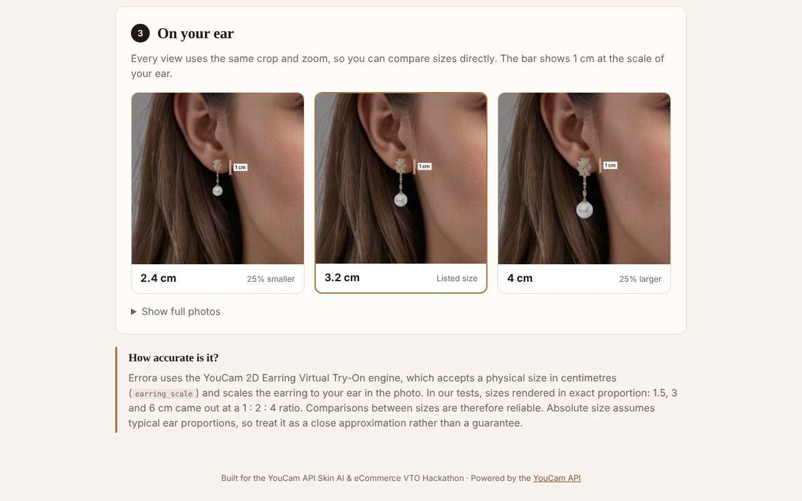
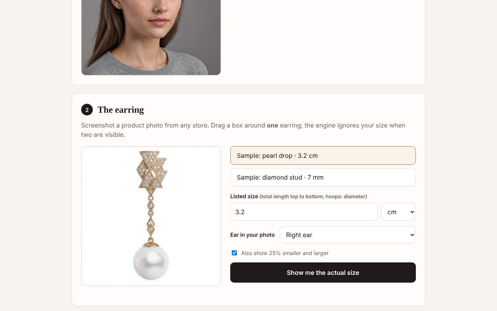
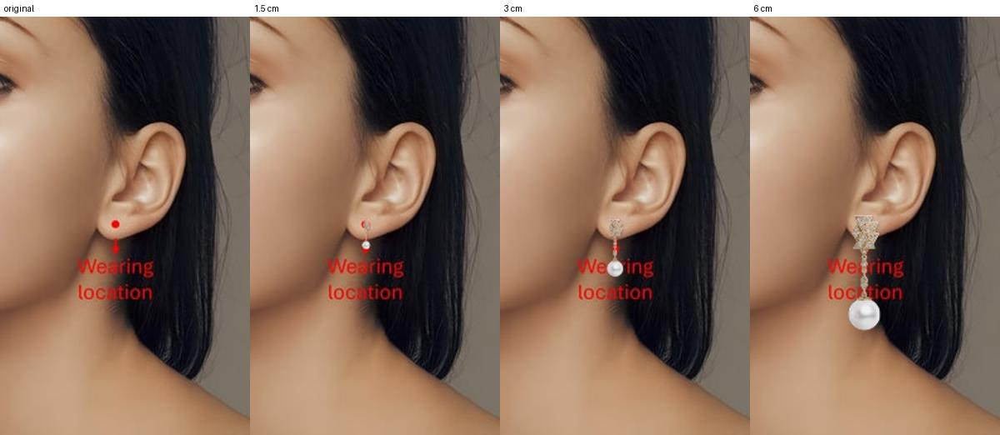

# Errora

> **Built for the [YouCam API Skin AI & eCommerce VTO Hackathon](https://youcam-api-skin-ai-ecommerce.devpost.com/)** (Perfect Corp. × Devpost, 2026)
> **Category:** Jewelry & Watch · **YouCam API used:** AI 2D Earring Virtual Try-On (`/s2s/v2.0/task/2d-vto/earring`)

**See earrings at the size they really are, on your own ear.**
Upload a screenshot of an earring from any online store, type in the size from the listing, and Errora renders it at that physical size on your photo, next to the same earring 25% smaller and 25% larger, with a 1 cm scale bar drawn at the scale of your ear.



---

## The problem

Earring product photos are cropped and zoomed until every piece fills the frame. A 12 mm hoop and a 30 mm hoop look identical on a product page. Retailers do list dimensions, but "3.2 cm" means little until it is on you. The result is a familiar pattern in earring reviews and returns: *smaller than expected*, *bigger than expected*.

Existing try-on tools solve "how does this style look on me". They do not solve "how big is this, really". Generative earring filters place jewelry at whatever size looks plausible, and brand-embedded size tools only work on the stores that license them.

## The solution

Errora is a store-agnostic size check for earrings:

1. **Your photo.** Upload a three-quarter-view photo with your ear visible (or use the sample model).
2. **The earring.** Upload a screenshot from any store and drag a box around a single earring (or use a sample). Enter the listed size in mm, cm or inches.
3. **On your ear.** Errora renders the earring at the listed size, plus 25% smaller and larger, in an identical crop and zoom so sizes can be compared directly. A 1 cm bar is drawn beside each render at the scale of your ear.



## How the YouCam API is used

The core of the app is the **AI 2D Earring Virtual Try-On** API and its `earring_scale` parameter, which sets the earring's size **in centimetres**. Errora passes the size from the product listing straight into that parameter, so the engine renders the earring at that physical size relative to the ear in the photo.

| Step | Endpoint | Purpose |
|---|---|---|
| 1 | `POST /s2s/v2.0/file/2d-vto/earring` | Get a pre-signed upload URL and `file_id` for the selfie and the cropped earring |
| 2 | `PUT <pre-signed URL>` | Upload the image bytes |
| 3 | `POST /s2s/v2.0/task/2d-vto/earring` | Create the try-on task with `earring_scale`, `earring_is_right_ear` and `earring_need_remove_background` |
| 4 | `GET /s2s/v2.0/task/2d-vto/earring/{task_id}` | Poll until the task succeeds, then download the render |

Request body used for each size:

```json
{
  "src_file_id": "<selfie file_id>",
  "ref_file_ids": ["<earring file_id>"],
  "source_info": { "name": "selfie.jpg" },
  "object_infos": [{
    "name": "earring.jpg",
    "parameter": {
      "earring_scale": 3.2,
      "earring_is_right_ear": true,
      "earring_need_remove_background": true
    }
  }]
}
```

All sizes for a session are rendered in parallel. Rendered images are served to the browser through a same-origin proxy (`/api/image`, restricted to YouCam result storage), so the client can compare them pixel by pixel against the original photo, find each rendered earring, apply one shared crop, and draw the scale bar.

**Cost:** 1 API unit per render. A typical session (listed size plus the 0.75× and 1.25× ladder) uses 3 units.

## Accuracy and validation

Accuracy claims are kept to what was measured.

- **Relative size is exact.** The same earring requested at 1.5, 3 and 6 cm rendered at 23, 46 and 92 px on the same photo: an exact 1 : 2 : 4 ratio. Side-by-side comparisons in the app are therefore reliable.
- **Absolute size is a close approximation.** On the test photo, the 6 cm render was about the length of the ear, consistent with typical adult ear proportions. The engine's method for estimating physical scale is not documented by YouCam, and accuracy has not yet been measured against real earrings on real people, so the app presents absolute size as an approximation based on typical ear proportions.



## Features

- Store-agnostic: works from any product screenshot, with no scraping and no retailer integration
- In-browser crop tool to isolate a single earring (the engine only honours the size setting when one earring is visible)
- Size entry in mm, cm or inches; left or right ear
- Size ladder (0.75×, 1×, 1.25×) in a shared crop and zoom for direct comparison
- 1 cm scale bar calculated from each render
- Built-in sample model and sample earrings, so anyone can try it without their own photo
- Clear error messages for unsupported photos (for example, a frontal photo where the ear is not visible)
- API key kept server-side; images are processed in memory and never stored

## Getting started

**Requirements:** Node.js 18 or later and a YouCam API key ([YouCam API console](https://yce.makeupar.com/api-console/en/api-keys/)). There are no npm dependencies.

```bash
git clone https://github.com/Abdullah49645/errora.git
cd errora
cp .env.example .env        # then set YOUCAM_API_KEY in .env
npm start
```

Open <http://localhost:3000>, choose **Use the sample model** and a sample earring, and select **Show me the actual size**.

### Environment variables

| Variable | Required | Description |
|---|---|---|
| `YOUCAM_API_KEY` | Yes | YouCam API key, sent as a Bearer token |
| `PORT` | No | Port to listen on (default `3000`) |
| `SAMPLE_MODEL_URL` | No | Public URL of the sample model photo. If unset, the bundled photo is uploaded through the File API |

### Deploying to Vercel

The repository is ready for [Vercel](https://vercel.com) with no build step: static files are served from `public/`, and `api/render.js`, `api/image.js` and `api/health.js` run as serverless functions sharing `lib/`.

1. Import the repository in Vercel (framework preset: **Other**).
2. Add the environment variable `YOUCAM_API_KEY`.
3. Deploy.

Any host that can run `node dev-server.js` works as well.

## Project structure

```
errora/
├── dev-server.js            # Local HTTP server: static files + API routes
├── api/                 # Vercel serverless functions (render, image, health)
├── lib/
│   ├── youcam.js        # YouCam API client: file upload, earring try-on task, polling, error mapping
│   └── render.js        # Shared render and image-proxy logic; keeps the API key server-side
├── public/
│   ├── index.html       # Three-step interface
│   ├── app.js           # Cropping, size handling, render request, change detection, scale bar
│   ├── styles.css
│   └── samples/         # Sample model and sample earrings
├── docs/                # Screenshots
├── vercel.json          # Vercel output directory and function settings
└── .env.example
```

### `POST /api/render`

```json
{
  "selfie":  { "sample": "model" },
  "earring": { "dataUrl": "data:image/png;base64,..." },
  "sizesCm": [2.4, 3.2, 4.0],
  "ear": "right"
}
```

`selfie` and `earring` each accept either `{ "sample": "<id>" }` or `{ "dataUrl": "<JPEG or PNG data URL>" }`. The response is `{ "results": [{ "cm": 3.2, "image": "/api/image?u=..." }] }`, where each `image` is a same-origin URL for the rendered photo.

## Limitations

- **Photo angle:** the earring engine needs a three-quarter view with the ear visible. Frontal photos are often rejected.
- **One earring per crop:** if both earrings of a pair are visible, YouCam ignores the size setting, so the crop step is required for pair photos.
- **What the size means:** `earring_scale` is applied to the full height of the earring in the product image. Enter the total top-to-bottom length; for hoops photographed face-on, that is the outer diameter.
- **Absolute accuracy** depends on how closely your ear matches typical proportions (see [Accuracy and validation](#accuracy-and-validation)).

## Privacy

Photos are sent only to the YouCam API to produce the renders. The server keeps nothing: images are held in memory for the duration of a request, and rendered images are streamed from YouCam's result storage to the browser.

## Sample assets

The sample model photo was generated with the YouCam Text-to-Image API. The sample earring images are YouCam's own documentation samples, loaded from YouCam's public media host.

## License

[MIT](LICENSE) © 2026 Abdullah Bin Saad
